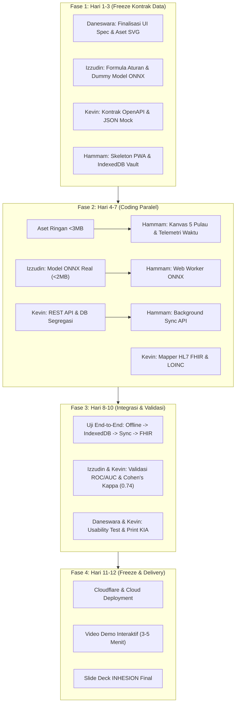

# 📋 Master Roadmap & Technical Task Distribution: NNTS (OtakAtik)
**Proyek**: Neuro-Nutrient Triage System (NNTS) / OtakAtik  
**Target Kompetisi**: INHESION 2026 — Universitas Gadjah Mada (UGM)  
**Batas Waktu Pengumpulan (Deadline)**: 21 November 2026  
**Target Selesai Tim (Internal Freeze)**: **20 November 2026** (H-1 sebelum deadline)  
**Rentang Waktu Kerja**: 9 November – 20 November 2026 (**12 Hari Intensif**)  
**Standar Kepatuhan**: IEC 62304 (Medical Device Software Lifecycle) & UU PDP No. 27/2022  

---

## 1. Struktur Tim & Pemetaan Peran (4 Orang)

Berdasarkan dokumen teknis resmi (*Spesifikasi Arsitektur Teknis & Pembagian Tugas Pengembangan NNTS*), tim inti terdiri dari 4 peran spesialisasi fungsional:

| No | Anggota Tim | Peran Utama (Spesialisasi) | Domain Fokus & Tanggung Jawab Kunci |
|:---:|:---|:---|:---|
| **1** | **Hammam Abdullah** | **Product Lead & Backend/Cloud Engineer** | • REST API Hono & Cloudflare Workers (`nnts-api`)<br>• Interoperabilitas HL7 FHIR R4 (LOINC & SNOMED-CT) & openEHR<br>• Keamanan UU PDP (Segregasi PII vs Telemetri Medis via `pseudo_uuid`) |
| **2** | **Muhammad Izzudin Yusuf** | **AI/ML & CDSS System Architect** | • Heuristic Rule-Based Expert System (WHO & Kemenkes)<br>• Model Unsupervised ML (PCA + K-Means) & Ekspor `.onnx`<br>• Algoritma kalibrasi latensi layar (Pondok Cakra) & Z-Score |
| **3** | **Kevin Kurniawan Cahyadi** | **Frontend Engineer & Game Telemetry Specialist** | • Arsitektur PWA Offline-First (<15 MB, Workbox, Dexie.js)<br>• Engine Kanvas Game 60 FPS & Telemetri `performance.now()`<br>• Integrasi Web Worker ONNX & Dashboard Triase Adaptif |
| **4** | **Daneswara R. R. Wicaksono** | **UI/UX Designer & Clinical Ergonomics Specialist** | • Sistem Desain Figma (4 Aktor: Kader, Balita, Dokter, Ortu)<br>• Aset gamifikasi Cakra SVG/Lottie terkompresi (<3 MB)<br>• Desain bebas alert fatigue (Tiered Alerts) & Kartu Rapor KIA |

---

## 2. Prinsip "Zero-Blocker Pipeline" (Semua Bisa Kerja Bareng)

Agar 4 orang dapat bekerja secara serentak (**konkuren**) tanpa saling menunggu:



1. **Kontrak Data Terkunci di Hari ke-2**: Semua payload JSON (IndexedDB, REST API, dan FHIR Bundle) disepakati di awal.
2. **Mocking First**:
   * Frontend bekerja menggunakan *Mock Data Provider* jika Backend belum siap.
   * Backend menguji endpoint menggunakan *Synthetic Telemetry Generator* tanpa menunggu game selesai dimainkan.
   * AI/ML mengekspor model versi *stub* (input array $\to$ output skor dummy) di hari ke-2 agar Frontend bisa menguji *Web Worker* sejak awal.
3. **Desain Komponen Mandiri**: UI Designer menyerahkan file token warna, ukuran, dan ikon SVG teroptimasi secara bertahap (per pulau petualangan).

---

## 3. Matriks Alur Kerja & Timeline Harian (9 – 20 November 2026)

### SPRINT FASE 1: Pondasi, Kontrak Data, & Wireframe (9 – 11 Nov / Hari 1–3)
**Target Milestone**: Seluruh kontrak API, skema basis data, arsitektur dasar, dan aset visual awal siap.

* **Muhammad Izzudin Yusuf (AI/ML)**:
  * [ ] Menuliskan skrip kalkulasi matematika Z-score antropometri (WHO Anthro 2006).
  * [ ] Membangun skrip sintetis dataset neurokognitif balita 24–59 bulan.
  * [ ] Menyiapkan *baseline model* PCA + K-Means di Scikit-learn dan ekspor versi *initial* ke `nnts-cdss-engine.onnx` (<2 MB).
  * [ ] Merumuskan formula kalibrasi latensi Pondok Cakra:  
    $$\text{Latency}_{\text{corrected}} = \text{Raw}_{\text{touch}} - (\Delta_{\text{frame}} + \text{Mechanical}_{\text{tap}})$$
* **Daneswara R. R. (UI/UX)**:
  * [ ] Menyelesaikan Design System di Figma (Palet Warna Ramah Anak, Tipografi, Komponen Kartu).
  * [ ] Merancang alur visual 5 Pulau Petualangan Cakra (Pondok, Balon Kilat, Pesta Buah, Lembah Hewan, Peti Emas).
  * [ ] Merancang antarmuka Workstation Dokter (2 kolom responsif dengan grafik telemetri).
  * [ ] Mengonversi dan mengompresi aset vektor SVG maskot burung Cakra via SVGO (<3 MB total).
* **Kevin Kurniawan Cahyadi (Clinical/Backend)**:
  * [ ] Menyusun kamus terminologi medis resmi: LOINC (56072-2 LiLA, 29463-7 BB, 8302-2 TB) dan SNOMED-CT.
  * [ ] Menulis file kontrak OpenAPI 3.0 (`swagger.yaml`) untuk 3 endpoint REST API utama.
  * [ ] Menyiapkan 10 skenario profil balita hipotetis (3 kasus Tier-1 Besi, 3 kasus Tier-1 Seng/B12, 2 kasus Gizi Buruk Kompleks, 2 Kasus Normal).
  * [ ] Menyiapkan skema PostgreSQL terpisah: `auth_pii_db` dan `telemetry_medical_db`.
* **Hammam Abdullah (Lead/Frontend)**:
  * [ ] Menginisialisasi repositori Vite + React + TypeScript + Tailwind CSS (sudah terverifikasi Vite 6 & Cloudflare).
  * [ ] Mengonfigurasi modul Dexie.js dengan skema `NNTS_Offline_Vault` (IndexedDB terenkripsi).
  * [ ] Menyiapkan *harness* Web Worker untuk menjalankan ONNX Runtime WebAssembly.
  * [ ] Membangun kerangka navigasi multi-role (Orang Tua, Kader Posyandu, Dokter Puskesmas).

---

### SPRINT FASE 2: Core Feature Build & Integrasi Paralel (12 – 15 Nov / Hari 4–7)
**Target Milestone**: MVP fungsional dapat dijalankan secara luring di browser: game mencatat milidetik, ONNX menghasilkan skor, dan data tersimpan di IndexedDB.

* **Muhammad Izzudin Yusuf (AI/ML)**:
  * [ ] Melatih model klasterisasi multivariat K-Means terstratifikasi umur (24–35 bln, 36–47 bln, 48–59 bln).
  * [ ] Memverifikasi konversi model ke ONNX Runtime Web (`ort.InferenceSession.create()`).
  * [ ] Mengimplementasikan generator pengacakan urutan stimulus pulau buah & hewan untuk mencegah *practice effect*.
  * [ ] Menyerahkan berkas bundle model final `nnts-cdss-engine.onnx` ke Frontend.
* **Hammam Abdullah (Lead/Frontend)**:
  * [ ] Mengimplementasikan kanvas game 60 FPS dengan W3C High-Resolution Time (`performance.now()`).
  * [ ] Membangun 5 modul petualangan:
    1. *Pondok Cakra*: Kalibrasi latensi layar (tap motorik dasar).
    2. *Pulau Balon*: Simple & Choice Reaction Time (SRT/CRT).
    3. *Kebun Buah*: Go/No-Go inhibitory task (buah segar vs busuk, stimulus 800 ms).
    4. *Lembah Hewan*: Digit Span Backward (visual-spatial working memory).
    5. *Puncak Emas / Peti Harta*: Selebrasi bintang dan pemicu evaluasi CDSS.
  * [ ] Menghubungkan eksekusi Web Worker ONNX untuk inferensi triase instan tanpa jeda antarmuka (*zero UI freeze*).
  * [ ] Membangun antarmuka formulir antropometri kader (dengan visual indikator warna pita LiLA otomatis).
* **Kevin Kurniawan Cahyadi (Clinical/Backend)**:
  * [ ] Membangun endpoint `POST /api/v1/sync/batch-screenings` dengan enkripsi TLS 1.3.
  * [ ] Membangun endpoint `GET /api/v1/fktp/{fktp_code}/worklist` terstratifikasi Tier Merah, Kuning, Hijau.
  * [ ] Membangun endpoint `POST /api/v1/fktp/encounters/{screening_uuid}/clinical-decision` (Human-in-the-Loop decision).
  * [ ] Membuat *generator converter* transaksi Bundle HL7 FHIR R4 berbasis TypeScript/Node.js.
* **Daneswara R. R. (UI/UX)**:
  * [ ] Melakukan uji ergonomi visual: memastikan font ramah anak, kontras tombol aksi $>4.5:1$ (WCAG AA).
  * [ ] Menyelesaikan antarmuka Laporan Pantau Tumbuh Kembang Keluarga (konsep 3 Medali Bintang).
  * [ ] Merancang format cetak ramah lembar Buku KIA (Kesehatan Ibu dan Anak).
  * [ ] Menyiapkan micro-assets animasi lottie untuk feedback reward anak (bintang berputar, balon meletus).

---

### SPRINT FASE 3: Interoperabilitas, Keamanan, & Uji Klinis (16 – 18 Nov / Hari 8–10)
**Target Milestone**: Integrasi end-to-end tuntas. Validasi matriks klinis terbukti, sinkronisasi offline-to-online berjalan aman.

* **Kevin Kurniawan Cahyadi & Hammam Abdullah (Backend & Integrasi)**:
  * [ ] Menguji alur sinkronisasi batch: saat sinyal mati, data antre di `screening_telemetry_queue`; saat sinyal aktif, Background Sync mengirim data ke backend.
  * [ ] Verifikasi mekanisme *auto-purge*: data PII lokal langsung dihapus otomatis dari tablet setelah status berubah menjadi `SYNCED` (kepatuhan gawai bersama Posyandu).
  * [ ] Validasi payload Bundle HL7 FHIR R4 terhadap validator skema SATUSEHAT Kemenkes RI.
  * [ ] Menyiapkan jembatan ekspor arketipe openEHR untuk RME internal Puskesmas.
* **Muhammad Izzudin Yusuf & Kevin Kurniawan Cahyadi (AI/ML & Validasi Klinis)**:
  * [ ] Melakukan uji sensitivitas, spesifisitas, dan kurva ROC/AUC model terhadap 10+ profil skenario klinis.
  * [ ] Mengukur tingkat kesesuaian konsensus pakar: memastikan target Cohen's $\kappa \ge 0,74$ tercapai.
  * [ ] Mengunci matriks intervensi nutrisi presisi: dosis sirup besi $3\text{ mg/kg BB/hari}$, suplementasi seng $10\text{--}20\text{ mg/hari}$, dan jadwal evaluasi kronobiologis 4–6 minggu.
* **Daneswara R. R. & Hammam Abdullah (UI Polish & Audit)**:
  * [ ] Audit performa Google Lighthouse PWA: target Skor $\ge 90$ untuk Performance, Accessibility, Best Practices, dan PWA.
  * [ ] Memastikan total ukuran bundel aplikasi tetap berada di bawah batas ambang **$< 15\text{ MB}$**.
  * [ ] Uji responsivitas lintas gawai: Tablet Posyandu (1280x800), Ponsel Kader (360x640 / 390x844), dan Laptop Dokter (1920x1080).

---

### SPRINT FASE 4: Final Freeze, Deployment, & Pitch Assets (19 – 20 Nov / Hari 11–12)
**Target Milestone**: Sistem dideploy live, video demo rekaman tuntas, slide presentasi siap kirim sebelum tanggal 21.

* **19 November 2026 (Full System Freeze & Live Deployment)**:
  * [ ] **Deployment Produksi**: Deploy build final PWA ke Cloudflare Pages / Workers (Edge Network).
  * [ ] **Smoke Test Menyeluruh**: Jalankan 1 sesi lengkap dari Meja Posyandu (Anak main $\to$ Kader ukur LiLA $\to$ Hasil Triage keluar $\to$ Dokter buka Worklist $\to$ Dokter beri resep $\to$ FHIR Bundle terbentuk).
  * [ ] **Code Freeze**: Kunci cabang `main` di GitLab/GitHub. Tidak ada lagi penambahan kode baru.
* **20 November 2026 (Target Selesai: Dokumentasi & Slide Final)**:
  * [ ] **Rekaman Video Demo (3–5 Menit)**: Menampilkan alur realistis meja Posyandu, game anak bersama Timi/Cakra, dashboard dokter, dan interoperabilitas SATUSEHAT.
  * [ ] **Finalisasi Slide Pitch**: Mengisi template presentasi resmi INHESION (`[PUB] Future Health Digital Innovation Challenge _ Submission Template.pptx`) dengan screenshot high-res sistem yang sudah berjalan.
  * [ ] **Penyusunan Berkas Teknis**: Mengompilasi naskah esai, laporan pengujian perangkat lunak medis (IEC 62304), dan lembar orisinalitas.
* **21 November 2026 (Official Deadline Day)**:
  * [ ] Buffer time aman. Submit seluruh berkas ke portal lomba INHESION UGM pagi hari sebelum batas akhir malam.

---

## 4. Matriks RACI Tanggung Jawab Tim (4 Orang)

* **R (Responsible)**: Pelaksana teknis utama tugas.
* **A (Accountable)**: Penanggung jawab kualitas & pengambil keputusan akhir.
* **C (Consulted)**: Memberi masukan & konsultasi teknis dua arah.
* **I (Informed)**: Mendapatkan update hasil kerja.

| Modul / Komponen Tugas | Hammam | Izzudin | Kevin | Daneswara |
|:---|:---:|:---:|:---:|:---:|
| **Arsitektur PWA Offline & IndexedDB Dexie** | C | C | **R / A** | I |
| **Engine Game Canvas 60 FPS & Telemetri Waktu** | I | C | **R / A** | C |
| **Mesin Aturan Deterministiik (Rule-Based CDSS)** | C | **R / A** | C | I |
| **Model Unsupervised ML (PCA + K-Means) & ONNX** | C | **R / A** | I | I |
| **Algoritma Kalibrasi Layar (Pondok Cakra)** | C | **R / A** | I | C |
| **REST API Sinkronisasi & Segregasi DB UU PDP** | **R / A** | I | C | I |
| **Konektor HL7 FHIR R4 & Standar LOINC** | **R / A** | I | I | I |
| **UI/UX Design System & Prototipe Figma** | C | I | C | **R / A** |
| **Aset Vektor Maskot Cakra & Game (SVG/Lottie)** | I | I | C | **R / A** |
| **Ergonomi Dashboard Dokter & Rapor Keluarga** | C | C | C | **R / A** |
| **Validasi Skenario Klinis & Cohen's Kappa** | **R / A** | C | I | I |
| **Slide Deck & Video Demo Lomba INHESION** | **A** | R | R | R |

---

## 5. Spesifikasi Kontrak Data & Mock Interfaces

Setiap anggota dapat mulai bekerja secara independen menggunakan skema data standar berikut:

### 5.1 Skema IndexedDB Lokal (`NNTS_Offline_Vault`)
```typescript
// Disepakati antara Hammam (Frontend) dan Kevin (Backend Sync)
interface LocalScreeningRecord {
  screening_uuid: string;              // UUIDv4
  subject_pseudo_uuid: string;        // UUIDv4 terpseudonimkan
  encounter_context: {
    posyandu_id: string;              // "POS-DIY-MLT03"
    fktp_code: string;                // "P3404010101"
    kader_operator_id: string;        // "KDR-8821"
    age_in_months: number;            // 24 - 59
    sex: "M" | "F";
    assessed_at_iso: string;
  };
  somatometry_input: {
    weight_kg: number;
    height_cm: number;
    muac_lila_cm: number;             // Ambang batas: <11.5 (Merah), 11.5-12.5 (Kuning), >12.5 (Hijau)
    strict_plant_based_diet: boolean;
  };
  neurocognitive_telemetry: {
    hardware_calibration_pondok_cakra: {
      measured_frame_delta_ms: number;
      baseline_mechanical_tap_ms: number;
      calibration_valid: boolean;
    };
    island_1_balon_srt_crt: {
      trials_count: number;
      hardware_corrected_latencies_ms: number[];
      mean_corrected_rt_ms: number;
      rt_sd_z_score: number;
    };
    island_2_kebun_buah_gonogo: {
      stimulus_duration_ms: number;   // 800 ms
      commission_errors: number;
      inhibitory_accuracy_percent: number;
    };
    island_3_lembah_hewan_digit_span: {
      span_length_achieved: number;
      reverse_span_z_score: number;
    };
  };
  triage_result: {
    tier: "TIER_1_MERAH" | "TIER_2_KUNING" | "TIER_HIJAU";
    suspected_deficiency: ("FE_LATEN" | "ZN_B12" | "COMPLEX_MACRO_MICRO" | "NORMOTRITION")[];
    cdss_confidence_score: number;
  };
  sync_status: "PENDING_UPLOAD" | "SYNCED" | "SYNC_FAILED";
}
```

### 5.2 Kontrak REST API Sinkronisasi (`POST /api/v1/sync/batch-screenings`)
* **Request Header**: `Authorization: Bearer <JWT_KADER_TOKEN>`
* **Request Body**:
```json
{
  "batch_id": "batch_20261118_001",
  "posyandu_id": "POS-DIY-MLT03",
  "records": [
    {
      "screening_uuid": "scr_7c6b5a4f-3e2d-4109-9876-5f4e3d2c1b0a",
      "subject_pseudo_uuid": "sub_9f8e7d6c-5b4a-4321-8765-1a2b3c4d5e6f",
      "triage_tier": "TIER_1_MERAH",
      "assessed_at": "2026-11-18T08:19:45.812+07:00",
      "telemetry_payload_encrypted_b64": "U2FsdGVkX1+9x8z7y6w5v..."
    }
  ]
}
```
* **Response Body (200 OK)**:
```json
{
  "status": "SUCCESS",
  "processed_count": 1,
  "synced_uuids": ["scr_7c6b5a4f-3e2d-4109-9876-5f4e3d2c1b0a"],
  "rejected_uuids": []
}
```

### 5.3 Kontrak Output Model ONNX (`nnts-cdss-engine.onnx`)
* **Input Tensor**: `float32[1, 8]`
  1. `age_months` (24–59)
  2. `sex` (0 = F, 1 = M)
  3. `muac_lila_cm`
  4. `weight_for_age_z`
  5. `height_for_age_z`
  6. `corrected_srt_ms`
  7. `gonogo_accuracy_pct` (0.0 – 1.0)
  8. `digit_span_backward_z`
* **Output Tensor**:
  * `triage_class`: `int64[1]` (0 = Normonutrisi, 1 = Resiko Fe Laten, 2 = Resiko Zn/B12, 3 = Malnutrisi Kompleks)
  * `probabilities`: `float32[1, 4]`

---

## 6. Rencana Kontinjensi (Jika Terjadi Kendala Waktu / Skill)

Jika ada salah satu komponen yang mengalami *delay* atau kendala teknis:

| Situasi Kendala | Rencana Kontinjensi (Jalur Cadangan Cepat) | Penanggung Jawab |
|:---|:---|:---:|
| **Kompilasi ONNX WebAssembly memakan waktu / error di browser** | Gunakan **TypeScript Rule-Based Engine** murni di sisi *client*. Matriks aturan Kemenkes/WHO sudah cukup kuat dan deterministik untuk kebutuhan demo MVP lomba. | Izzudin & Hammam |
| **Backend REST API belum sempat dideploy di cloud** | Jalankan sistem dalam mode **100% Client-Side Local Demo** menggunakan IndexedDB + mock storage browser. Antrean dokter membaca langsung dari database browser yang sama. | Kevin & Hammam |
| **Koneksi nyata ke Sandbox SATUSEHAT mengalami rate-limit / token lambat** | Gunakan modul **Synthetic FHIR R4 Bundle Export Previewer**: sistem menghasilkan dokumen JSON standar HL7 FHIR resmi yang dapat diunduh langsung dari tombol dashboard dokter. | Kevin |
| **Aset Lottie/Animasi visual belum tuntas semua** | Manfaatkan **SVG Statis Interaktif + CSS Keyframes**: tetap ringan (<100 KB), performa 60 FPS terjamin, dan tidak membebani memori tablet. | Daneswara |

---

## 7. Rangkuman Target Akhir Tanggal 20 November 2026

Pada tanggal **20 November 2026 pukul 21:00 WIB**, tim harus sudah memegang:
1. ✅ **Link Web Demo Aktif** (PWA di Cloudflare Pages yang bisa dibuka di HP & Laptop).
2. ✅ **Video Demo MP4 Berdurasi 3–5 Menit** (Menunjukkan alur skrining anak, hasil triage cepat, dan worklist dokter).
3. ✅ **File Presentasi PPTX / PDF** terisi lengkap sesuai template resmi INHESION.
4. ✅ **Repositori Kode Bersih** dengan dokumentasi `README.md` dan lisensi proyek.

*Dengan pembagian kerja ini, seluruh 4 anggota memiliki tugas konkret sejak hari pertama tanpa saling menunggu.*
